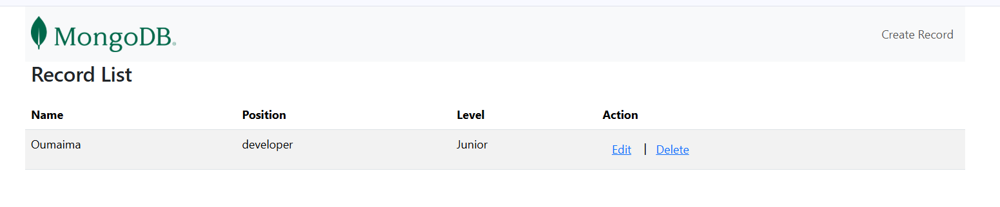
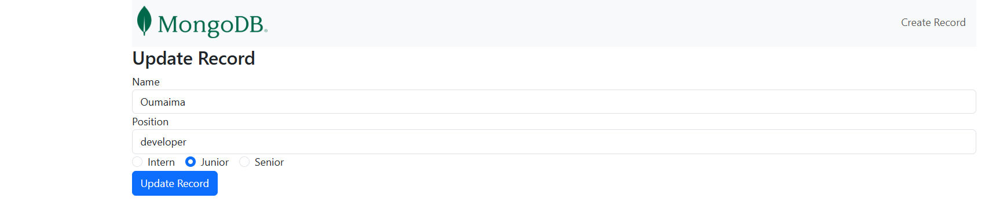
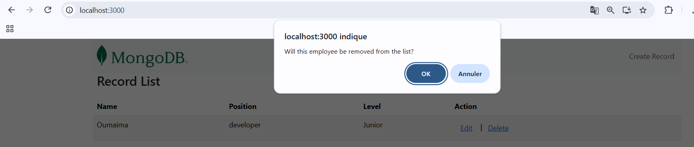
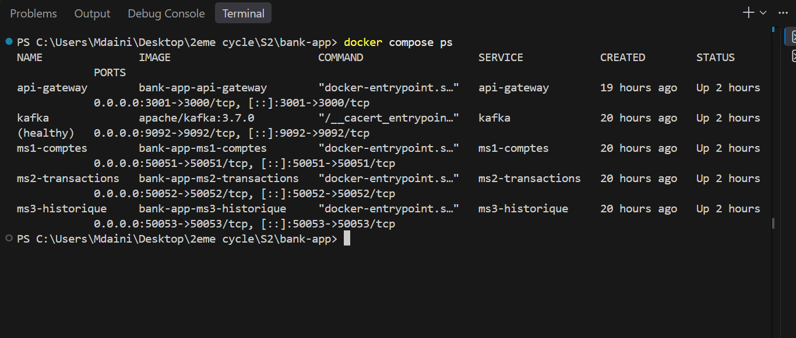
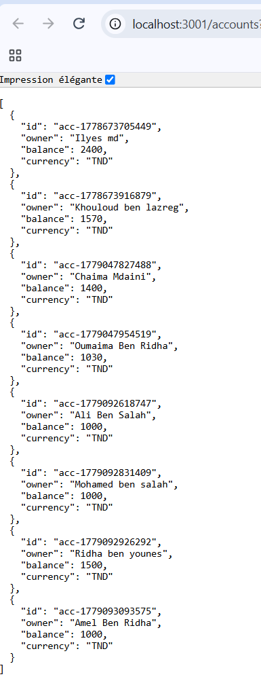

# TP2 – Docker et Docker Compose

**Auteur :** Oumaima Mdaini  
**Établissement :** École Polytechnique de Sousse  
**Année universitaire :** 2026–2027  
**Module :** DevOps

## Présentation du TP

Ce dépôt présente la conteneurisation de deux applications avec Docker et Docker Compose :

1. **Application MERN** : MongoDB, Express, React et Node.js.
2. **Application bancaire basée sur une architecture microservices** : trois microservices, une API Gateway et Kafka.

L'objectif est de construire les images Docker, configurer les conteneurs, les réseaux, les volumes et vérifier le fonctionnement des applications.

## Prérequis

- Docker Desktop ou Docker Engine.
- Docker Compose.
- PowerShell ou un terminal.
- Un navigateur web.

Vérification de l'installation :

```bash
docker --version
docker compose version
```

---

# Partie 1 – Application MERN

## 1. Architecture

L'application est composée de trois services :

```text
mern-app/
├── client/
│   ├── Dockerfile
│   └── .dockerignore
├── server/
│   ├── Dockerfile
│   └── .dockerignore
└── docker-compose.yml
```

| Service | Technologie | Port |
|---|---|---|
| client | React | 3000 |
| server | Node.js / Express | 9000 |
| mongodb | MongoDB 7 | 27017 (interne) |

## 2. Dockerfiles

Deux Dockerfiles ont été créés :

- **Client :** construction de l'application React avec `npm run build`, puis utilisation de `serve` pour servir les fichiers générés.
- **Serveur :** installation des dépendances Node.js et démarrage de l'API Express avec `npm start`.

Les fichiers `.dockerignore` permettent d'exclure les fichiers inutiles à la construction des images, notamment `node_modules`, les fichiers `.env` et les fichiers temporaires.

## 3. Lancement manuel

Depuis le dossier `mern-app` :

```powershell
# Construction des images
cd server
docker build -t mern-server .
cd ..

cd client
docker build -t mern-client .
cd ..

# Création du réseau et du volume
docker network create mern-network
docker volume create mern-data

# Démarrage de MongoDB
docker run -d --name mongodb --network mern-network -v mern-data:/data/db mongo

# Démarrage du serveur
docker run -d --name server --network mern-network -p 9000:9000 -e "MONGO_URI=mongodb://mongodb:27017/employees" mern-server

# Démarrage du client
docker run -d --name client --network mern-network -p 3000:3000 mern-client

# Vérification
docker ps
docker logs server
```

Le serveur utilise le nom `mongodb` pour communiquer avec la base de données à travers le réseau Docker.

## 4. Lancement avec Docker Compose

Depuis le dossier `mern-app` :

```powershell
docker compose up -d --build
docker compose ps
docker compose logs
```

Pour arrêter les conteneurs :

```powershell
docker compose down
```

Pour arrêter les conteneurs et supprimer les volumes :

```powershell
docker compose down -v
```

**Accès à l'application :**

- Frontend : http://localhost:3000
- API Backend : http://localhost:9000

MongoDB utilise un volume nommé afin de conserver les données lors des redémarrages. Le serveur dépend de l'état de santé de MongoDB (`service_healthy`).

## 5. Tests effectués

Les tests réalisés comprennent :

- Vérification de l'état des conteneurs avec `docker compose ps`.
- Vérification des logs du serveur et de la connexion à MongoDB.
- Accès à l'interface React depuis le navigateur.
- Tests des opérations CRUD.
- Arrêt et redémarrage des conteneurs.
- Vérification de la persistance des données.

---

# Partie 2 – Application bancaire Microservices

## 1. Architecture

L'application bancaire est composée de cinq services :

```text
Navigateur
    |
    v
API Gateway (3001)
    |
    ├── MS1 - Comptes (50051)
    |
    ├── MS2 - Transactions (50052)
    |
    └── MS3 - Historique (50053)

Kafka (9092)
```

| Service | Rôle | Port hôte |
|---|---|---|
| api-gateway | API REST et GraphQL | 3001 |
| ms1-comptes | Gestion des comptes | 50051 |
| ms2-transactions | Gestion des transactions | 50052 |
| ms3-historique | Gestion de l'historique | 50053 |
| kafka | Broker de messages | 9092 |

## 2. Dockerfiles

Chaque service possède son propre Dockerfile :

```text
bank-app/
├── api-gateway/
│   └── Dockerfile
├── ms1-comptes/
│   └── Dockerfile
├── ms2-transactions/
│   └── Dockerfile
├── ms3-historique/
│   └── Dockerfile
├── proto/
└── docker-compose.yml
```

Les Dockerfiles utilisent Node.js Alpine, installent les dépendances, copient le code source et démarrent chaque service avec `index.js`.

Les microservices MS1 et MS2 installent également les outils nécessaires à la compilation de certaines dépendances natives.

## 3. Configuration Docker Compose

Le fichier `docker-compose.yml` permet de lancer les cinq services.

Les principales configurations réalisées sont :

- Création d'un réseau bridge personnalisé nommé `bank-network`.
- Communication entre les conteneurs à travers leurs noms de services.
- Montage du dossier `proto` dans les conteneurs sous `/proto`.
- Utilisation des volumes `ms1-data` et `ms2-data`.
- Configuration des variables d'environnement.
- Configuration d'un healthcheck pour Kafka.
- Définition des dépendances entre les services avec `depends_on`.

L'API Gateway utilise le port 3001 sur la machine hôte et le port 3000 à l'intérieur du conteneur.

## 4. Démarrage des microservices

Depuis le dossier `bank-app` :

```powershell
docker compose up -d --build
docker compose ps
```

Pour consulter les logs :

```powershell
docker compose logs api-gateway
docker compose logs ms1-comptes
docker compose logs ms2-transactions
docker compose logs ms3-historique
docker compose logs kafka
```

Pour arrêter les services :

```powershell
docker compose down
```

## 5. Tests REST et GraphQL

L'API Gateway est accessible à l'adresse :

**http://localhost:3001**

### API REST

Endpoint de consultation des comptes :

```text
GET http://localhost:3001/accounts
```

### API GraphQL

Endpoint :

```text
http://localhost:3001/graphql
```

Le schéma GraphQL propose les requêtes suivantes :

- `accounts` : récupérer la liste des comptes.
- `account` : consulter un compte par son identifiant.
- `history` : consulter l'historique d'un compte.

Les mutations disponibles sont :

- `createAccount` : créer un compte.
- `deposit` : effectuer un dépôt.
- `withdraw` : effectuer un retrait.
- `transfer` : effectuer un transfert.

Exemple de requête GraphQL :

```graphql
query {
  accounts {
    id
    owner
    balance
    currency
  }
}
```

Les tests fonctionnels ont été réalisés à travers l'API REST et GraphQL, notamment la consultation des comptes et les opérations de gestion des transactions.

---

# Captures d'écran

Les captures illustrant les étapes de réalisation et les tests sont regroupées dans le dossier :

```text
captures/
```

Les captures comprennent notamment :

1. Construction et lancement des conteneurs MERN.

2. Vérification des conteneurs et des logs MERN.

3. Tests CRUD de l'application MERN.



4. Vérification des cinq conteneurs de Bank App.

5. Test de l'API REST `/accounts`.

6. Test de la requête GraphQL `accounts`.

7. Tests des mutations GraphQL.


8. Consultation de l'historique des transactions.


---

# Diagnostic et commandes utiles

| Commande | Utilité |
|---|---|
| `docker ps` | Afficher les conteneurs actifs |
| `docker compose ps -a` | Afficher tous les conteneurs du projet |
| `docker compose logs` | Consulter les logs |
| `docker compose up -d --build` | Construire et démarrer les services |
| `docker compose down` | Arrêter et supprimer les conteneurs |
| `docker network ls` | Afficher les réseaux Docker |
| `docker volume ls` | Afficher les volumes Docker |

---

# Conclusion

Ce TP a permis de mettre en pratique Docker et Docker Compose à travers deux applications différentes.

La première partie a porté sur la conteneurisation d'une application MERN composée d'un frontend React, d'un backend Express et d'une base de données MongoDB.

La deuxième partie a permis de conteneuriser une architecture microservices bancaire intégrant une API Gateway, trois microservices, Kafka et des communications gRPC.

Les tests réalisés ont permis de vérifier le démarrage des conteneurs, la communication entre les services et le fonctionnement des applications.

Ce travail a permis de mieux comprendre la construction des images Docker, l'orchestration des conteneurs, la gestion des réseaux et la persistance des données.